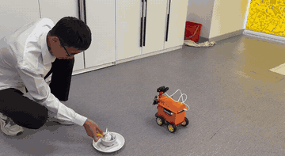
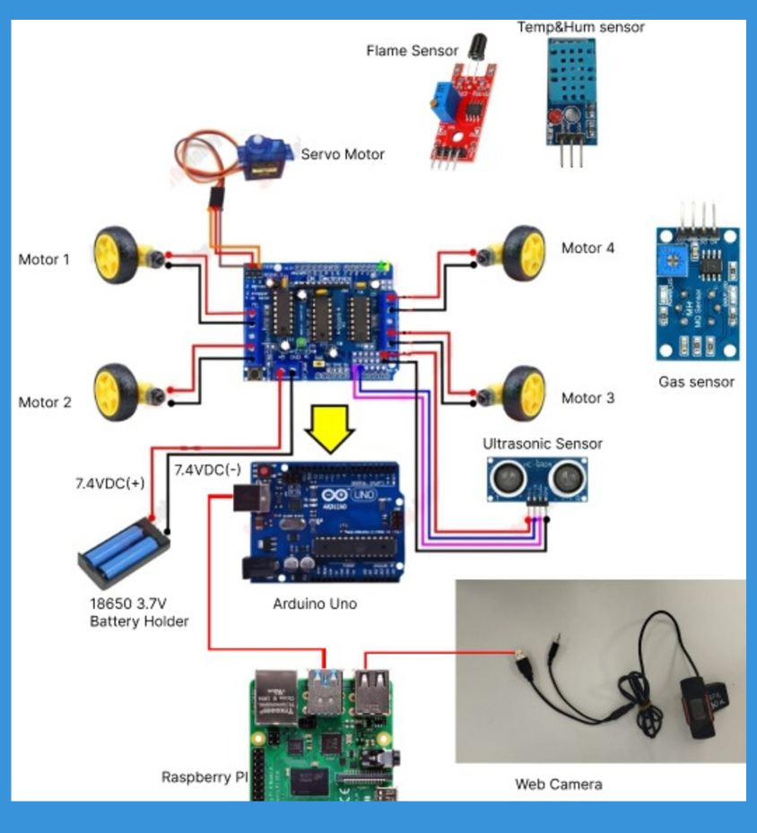
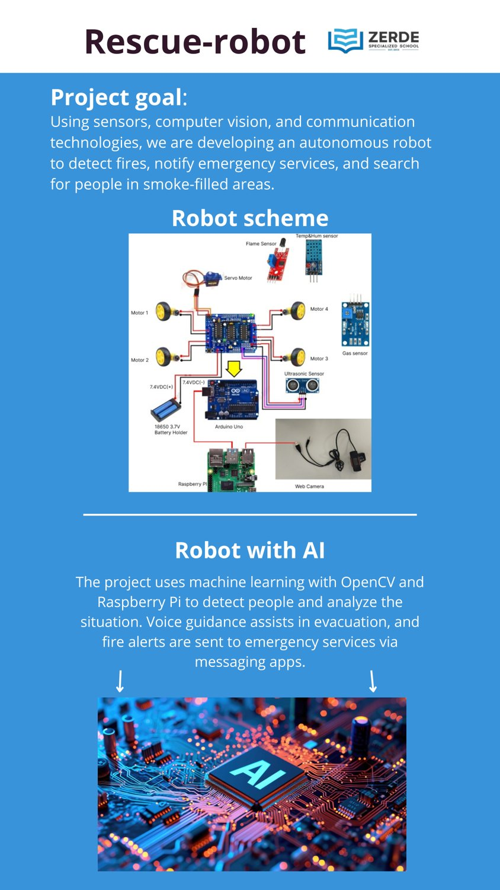

# Sunda — autonomous firefighter & rescue robot 🔥🤖

**Smart robot. Instant reaction. Saved lives.**

Sunda is a DIY autonomous robot that detects fire, smoke and gas leaks, searches for people in smoke-filled rooms with computer vision, and instantly sends an alert with a photo and sensor data to a Telegram channel.

Our first project with **Raspberry Pi and machine vision** — built in 2025 (10th grade) by team **SaveZone**, Specialized Lyceum No. 9 "Zerde", Astana.

🏁 Competed at **WRO 2025** (theme "The Future of Robots") and **RoboLand 2025**.

  

🎥 [Full demo video](sunda_demo.mp4)

---

## Why

Fires and gas leaks at home often go unnoticed until it's too late — especially in villages far from fire stations, where the call comes in only when the house is already burning. While working on the project we also interviewed a fire sergeant from Astana's Specialized Fire Unit No. 4 about how early detection works in remote areas.

## What it does

- 🔥 Detects **fire** (flame sensor), **smoke and gas** (MQ-135), **temperature and humidity** (DHT-11)
- 🧍 Finds **people** on the camera image with **YOLOv8 + OpenCV**
- 🚗 Drives **autonomously** and avoids obstacles with an ultrasonic sensor on a servo
- 📲 Sends a report to the **Telegram** channel *DangerAlarm*: photo, detected people, temperature, humidity, gas level
- 🔊 Buzzer signals to help with evacuation

## Architecture

Two boards talking over USB:

| Board | Role |
|---|---|
| **Raspberry Pi 3 Model B** — "the brain" | Camera processing, YOLOv8 people detection, decisions, Telegram bot, flashing the Arduino |
| **Arduino Uno R3** + L293D motor shield | 4 DC motors, servo, sensors; streams sensor data to the Pi over serial |

**The tricky part:** an Arduino Uno holds only one sketch at a time. So we made the Raspberry Pi **re-flash the Arduino on the fly** over USB, loading a different sketch depending on the situation (patrol mode, rescue mode, etc.).

  

### Hardware

- Raspberry Pi 3 Model B, USB web camera
- Arduino Uno R3 + L293D motor shield, 4 × DC gear motors
- HC-SR04 ultrasonic sensor (A0 Trig / A1 Echo) on a servo (D10)
- MQ-135 gas sensor (A3), KY-026 flame sensor (A2), DHT-11 (D2)
- LCD 1602 over I2C
- 18650 batteries for motors, power bank for the Pi

### Software

- **Raspberry Pi (Python):** OpenCV, YOLOv8, PySerial, Telegram bot (telebot / aiogram)
- **Arduino (C++):** motor control, obstacle avoidance, sensor readings, serial commands from the Pi

## Logic

1. Arduino reads sensors and sends data to the Pi
2. Pi analyses the camera image — looks for people and fire
3. If danger is detected → photo + data go to Telegram
4. If the situation changes → Pi uploads the right sketch to the Arduino

## Cost of components (prototype)

Arduino Uno ~$4 · Raspberry Pi 3 ~$50 · web camera ~$19 · motor driver ~$4 · power bank ~$23 · SD card ~$9 · other sensors ~$92

## Team SaveZone

- **Adilet Bakytzhanuly** ([@Adikich](https://github.com/Adikich)) — programming: Raspberry Pi code, computer vision, Arduino code, Telegram bot
- **Yerasyl Zholdybay** — circuits and robot assembly

Supervisor: Gulsara Zhumagatova, computer science teacher, Specialized Lyceum No. 9 "Zerde"

  

